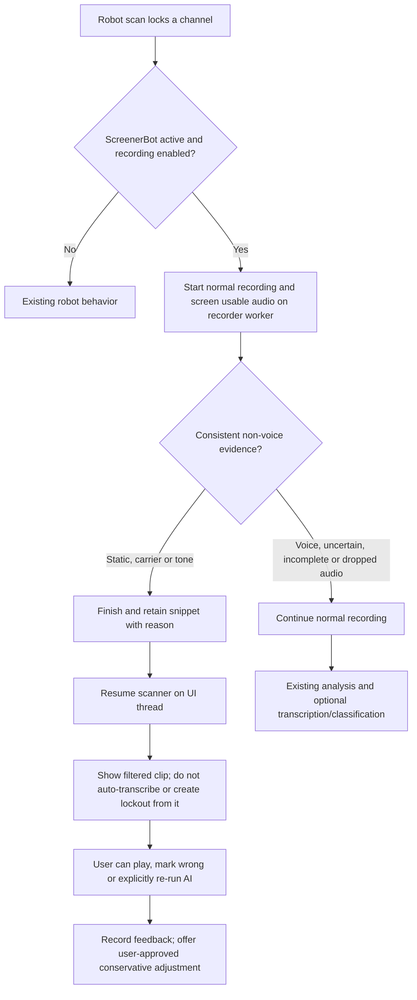

# ScreenerBot: wide-range robot scanning plan

## Purpose and decisions

ScreenerBot is an optional screening mode for the existing **robot scan**, not a
replacement for normal scanning. It helps the robot move past likely static,
carriers and tones when searching a wide, noisy range. Existing normal scans and
robot scans must retain their current behavior unless the user activates this
mode. Switching modes during a lock takes effect on the next lock.

- Provide separate, visible activation and configuration controls. Start in
  normal mode; keep the screening duration as a separate persisted setting.
- Recording must be enabled for screening. Do not silently change the user's
  recording, transcription, classification, or lockout settings.
- Record from the lock as usual while screening. Log and skip confidently
  identified static, carriers and tones, then resume the scanner. Retain the
  captured snippet and the reason for review. A snippet cannot recover the
  remainder of the transmission.
- Continue recording if speech is detected, the result is uncertain, audio is
  insufficient, the worker falls behind, or an audio block is dropped. Short
  transmissions should not be rejected merely for being short.
- Display analyzing, continued, and filtered states and the filter reason. Use
  the existing clip list, playback, Wrong, and Re-run AI actions for review.
- Track corrections, but do not change thresholds automatically. Offer a
  conservative adjustment for explicit user approval; corrections are not a
  statistically valid estimate of missed transmissions.

## Existing behavior and design constraints

The scanner measures RF strength and controls hold/release independently of
the robot. The robot's existing audio tap sends floating-point audio to a
bounded recorder queue; the recorder already runs on its own thread and trims
the first 0.3 seconds after tuning. `SpeechSkipDetector` uses `ClipAnalyzer`
on two-second windows and requires at least six seconds before an existing
optional speech-based skip. The UI timer resumes the scanner on early skip.
The existing post-recording path transcribes **all retained clips** when
transcription is enabled, not only clips classified as voice.

The earlier 500 ms proposal and its claimed reliability were not validated.
Half a second cannot satisfy the analyzer's default one-second speech
requirement and may contain silence before speech. Begin with a configurable
four-second minimum of usable audio, evaluated in two-second windows, and
require consistent non-voice evidence across the window. This is an
engineering starting point, not an accuracy guarantee. Recording begins
immediately, not after the screening interval. The same thresholds apply
across demodulation modes; real radio testing may show they need revision.

## Flow

## Implementation steps

1. Reuse the recorder's worker and `ClipAnalyzer`; add a dedicated per-lock
   screener with bounded windows. Do not block the DSP or UI threads. Snapshot
   mode and configuration per lock. Guard against stale results, queued audio,
   dropped blocks, stopped scanning, retunes and shutdown.
2. Wire a screened decision through the existing UI-thread resume mechanism.
   The decision must close the clip with a distinct reason before resuming.
   Ordinary recorder, scanner, and robot behavior remains unchanged in normal
   mode. Existing early-skip controls remain independent.
3. Persist the screening reason with the clip, including database migration.
   Keep the snippet, bypass automatic transcription and automatic lockout
   evaluation for filtered clips, and permit explicit AI reprocessing. Do not
   treat a screened fragment as evidence for automatic lockouts.
4. Add an activation control and separate settings for screening duration,
   plus status and reason feedback. Show the recording prerequisite and
   next-lock switching semantics. Keep settings independent of normal robot
   controls.
5. Reuse the existing Wrong action to record review feedback for filtered
   clips. Offer a longer screening interval when reviewing corrections, but
   require explicit approval before applying it. Preserve review evidence and
   avoid claims of automatic learning or statistically measured accuracy.
6. Document operation, failure behavior, retention and limitations. Replace
   the previous speculative pseudocode and contradictory rollout assumptions.

## Validation and release checks

- Unit-test synthetic static, tone, silence, speech-like, mixed and interrupted
  audio; include insufficient audio and repeated windows. Synthetic audio does
  not establish accuracy on real radio signals.
- Exercise recorder queue drops, queued-audio races, rapid consecutive locks,
  configuration snapshots, mode changes, and retained filtered snippets.
- Test database migration, status/reason persistence, correction feedback,
  explicit reprocessing, and exclusion from automatic transcription/lockouts.
- Run existing robot and scanner checks and build the application. Verify normal
  mode and existing early-skip behavior remain unchanged.
- Test the controls and scanner on real SDR hardware with representative AM/FM
  voice, static, carrier and digital signals before relying on this mode.
  Measure false skips against independently reviewed complete transmissions;
  corrections to truncated snippets alone cannot measure missed speech. Tune
  defaults only after collecting representative labeled data.

## Limitations

Screening uses heuristics, not a calibrated probability or semantic
understanding. Noise can precede speech, tones can be part of a transmission,
and valid digital communication can resemble unwanted noise. A filtered
transmission is cut short and cannot be recovered; the retained snippet only
contains audio actually recorded. The normal scan's lockouts, squelch, hold,
recording, storage and device settings continue to apply.
